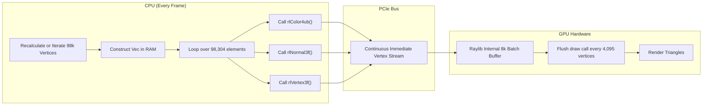

# MUX 0.3.0 Developer Experience & Architectural Friction Report

A comprehensive technical critique, empirical analysis, and architectural RFC for the **MUX 0.3.0** engine ecosystem (`muxapp`, `muxui`, `muxutils`, `GSS`, and `raylib-rs`), based on empirical evidence from production-scale applications: [`lowpoly-procedural-worlds`](file:///home/marcos/Projects/lowpoly-procedural-worlds) and [`computacao-grafica`](file:///home/marcos/Projects/computacao-grafica).

---

## 1. Executive Summary & Ecosystem Overview

### 1.1 The Evolution of MUX
Over iterations 0.2.0 and 0.3.0, the **MUX** framework made substantial progress toward delivering a modern, data-oriented Rust game framework powered by the GSS stylesheet engine and Raylib. Key achievements include:
- **Safe 3D RAII Scopes**: Replacing raw C FFI calls with `muxui::d3::draw_3d(camera, |d3| { ... })` and `d3.push_matrix(|ctx| { ... })`.
- **First-Class Vector Math**: Standard operator overloading (`+`, `-`, scalar `*`, `/`) and geometric utilities (`dot`, `cross`, `normalize`, `distance`, `lerp`) on `Vector3` and `Vector2`.
- **Scene Router Foundations**: Introducing the `Scene<Context>` trait and `SceneRouter` supporting `Switch`, `Push`, and `Pop` actions.
- **Semantic Input Abstraction**: Mapping hardware keys to named semantic actions and analog axes (`register_action`, `register_axis`, `register_mouse_axis`).
- **Dynamic GSS Integration**: Live stylesheet reloading and typed data binding through `FromGssValue` and `style.get_val_or(...)`.
- **Mutable 2D Pass Context (`e7a0f95`)**: Updating `Scene::draw_2d` to accept `&mut Context`, eliminating the borrow-checker friction that previously prevented UI buttons from mutating application state directly.

### 1.2 Evaluation Context
This report synthesizes empirical data collected while developing two ambitious real-time 3D projects:
1. **[`computacao-grafica`](file:///home/marcos/Projects/computacao-grafica)**: A planetary flight simulator featuring Newtonian spaceship physics, atmospheric lift/drag, procedural planetary heightmaps, landing runways, and a third-person chase camera.
2. **[`lowpoly-procedural-worlds`](file:///home/marcos/Projects/lowpoly-procedural-worlds)**: An infinite procedural terrain explorer with dynamic multi-octave Simplex noise, 7 distinct biome classifications, faceted animated water, procedural prop distribution, and day-night lighting cycles.

While both projects run at 60 FPS, implementation revealed key architectural friction points, ergonomic bottlenecks, and performance hazards that force developers to write boilerplate or resort to `unsafe` C FFI escapes.

---

## 2. Scene Lifecycle & State Flow

```mermaid
sequenceDiagram
    autonumber
    actor User
    participant Router as SceneRouter
    participant World as WorldScene (Active)
    participant Pause as PauseOverlay (Pushed)
    participant Window as Render Texture / Canvas

    User->>World: Clicks "Pause" button in draw_2d
    Note over World: draw_2d returns ()!<br/>Cannot return SceneAction::Push!
    World->>World: Set flag: self.pause_requested = true
    Note over World,Router: 1 FRAME DELAY
    Router->>World: update(&mut ctx, &input, dt)
    World->>Router: returns SceneAction::Push("pause")
    Router->>Pause: on_enter(&mut ctx, &style)
    
    rect rgb(60, 20, 20)
    Note over Router,Window: The Stacking & Transparency Bug
    Window->>Window: clear_background(0x181818FF)
    Router->>Pause: draw_3d(&ctx)
    Router->>Pause: draw_2d(&mut ctx, &style)
    Note over Window: WorldScene is NOT drawn!<br/>Translucent dark overlay renders over gray void!
    end
```



### 2.1 The `draw_2d` Action Latency & Flag Dance
#### The Problem
In MUX 0.3.0, the `Scene` trait defines:
```rust
fn update(&mut self, ctx: &mut Context, input: &Input, style: &Style, dt: f32) -> SceneAction;
fn draw_3d(&mut self, ctx: &Context);
fn draw_2d(&mut self, ctx: &mut Context, style: &Style);
```
While `e7a0f95` allowed `draw_2d` to mutate `Context`, `draw_2d` returns `()`. As a consequence, UI button interactions (such as "Resume Game", "Quit to Menu", or "Settings") **cannot command a `SceneAction` directly**.

#### Empirical Evidence
To navigate between scenes from UI buttons, developers are forced to store state flags and defer action emission to the next frame's `update()`:

*From [`computacao-grafica/src/scenes/pause.rs#L8-L35`](file:///home/marcos/Projects/computacao-grafica/src/scenes/pause.rs#L8-L35):*
```rust
#[derive(Default)]
pub struct PauseOverlayScene {
    resume_requested: Cell<bool>,
    switch_scene_requested: Cell<Option<String>>,
}

impl Scene<AppState> for PauseOverlayScene {
    fn update(&mut self, _state: &mut AppState, input: &Input, _style: &Style, _dt: f32) -> SceneAction {
        if let Some(target) = self.switch_scene_requested.take() {
            return SceneAction::Switch(target);
        }
        if input.is_action_pressed("pause") || self.resume_requested.take() {
            return SceneAction::Pop;
        }
        SceneAction::None
    }

    fn draw_2d(&mut self, _state: &AppState, style: &Style) {
        let resume_btn = Button::new("Resume Flight (P)");
        if resume_btn.clicked() {
            self.resume_requested.set(true); // Flag dance
        }
    }
}
```

*From [`lowpoly-procedural-worlds/src/main.rs#L243-L281`](file:///home/marcos/Projects/lowpoly-procedural-worlds/src/main.rs#L243-L281):*
```rust
#[derive(Default)]
pub struct PauseOverlayScene {
    pause_resume: bool,
}

impl Scene<AppState> for PauseOverlayScene {
    fn update(&mut self, _state: &mut AppState, input: &Input, _style: &Style, _dt: f32) -> SceneAction {
        if input.is_action_pressed("pause") || self.pause_resume {
            self.pause_resume = false;
            return SceneAction::Pop;
        }
        SceneAction::None
    }

    fn draw_2d(&mut self, state: &mut AppState, style: &Style) {
        let resume_btn = Button::new("Resume World");
        if resume_btn.clicked() {
            self.pause_resume = true; // Flag dance
            return;
        }
    }
}
```

#### Impact
1. **Unnecessary State & Boilerplate**: Every scene with interactive navigation buttons must declare and manage intermediate booleans or `Cell<Option<String>>` fields.
2. **One-Frame Latency**: The scene transition takes an extra frame to trigger because the UI event occurs in `draw_2d`, but the transition is only evaluated in the subsequent frame's `update()`.

---

### 2.2 The Modal Stacking & Transparency Blocker
#### The Problem
In [`muxapp/src/lib.rs#L444-L460`](file:///home/marcos/Projects/mux/muxapp/src/lib.rs#L444-L460):
```rust
begin_texture_mode(target);
clear_background(get_color(0x181818FF));

if let Some(scene) = scenes.active_scene_mut() {
    let action = scene.update(&mut context, &input, &style, dt);
    scene.draw_3d(&context);
    scene.draw_2d(&mut context, &style);
    match action {
        SceneAction::Push(target_name) => scenes.push(&target_name, &mut context, &style),
        SceneAction::Pop => scenes.pop(&mut context),
        ...
    }
}
```
The render texture is unconditionally cleared to `0x181818FF` at the start of every frame, and **only the top scene (`scenes.active_scene_mut()`) is drawn**.

#### Empirical Evidence
In both `computacao-grafica` and `lowpoly-procedural-worlds`, developers implemented pause menus using `SceneAction::Push("pause")` and drew translucent dark backdrops:
```rust
// computacao-grafica/src/scenes/pause.rs#L41:
draw_rectangle_rec(get_virtual_screen_rect(), get_color(0x000000CC));

// lowpoly-procedural-worlds/src/main.rs#L267:
draw_rectangle_rec(get_virtual_screen_rect(), get_color(0x0C121ACC));
```
Both authors intended to show a semi-transparent dark tint over the frozen 3D scene. However, because the underlying scene (`WorldScene` / `PlanetFlightScene`) is never rendered while `PauseOverlayScene` is active, the user sees a dark overlay over an empty gray canvas (`0x181818FF`).

#### Root Cause
The `SceneRouter` treats the scene stack strictly as an **execution stack**, not a **composite render stack**. Pushing a modal overlay completely conceals underlying scenes unless custom multi-scene rendering logic is written.

---

## 3. 3D Graphics & Vertex Pipeline

### 3.1 Immediate-Mode CPU Vertex Streaming Bottleneck
#### The Problem
Currently, MUX renders all custom 3D geometry via immediate-mode vertex submission. In `muxui::d3::Render3DContext`:
```rust
pub fn draw_trimesh_buffered(&self, vertices: &[Vertex3D]) {
    const MAX_CHUNK_VERTICES: usize = 4095;
    for chunk in vertices.chunks(MAX_CHUNK_VERTICES) {
        unsafe {
            rlgl::rlCheckRenderBatchLimit(chunk.len() as i32);
            rlgl::rlBegin(rlgl::RL_TRIANGLES as i32);
            for v in chunk {
                rlgl::rlColor4ub(v.color.r, v.color.g, v.color.b, v.color.a);
                if let Some(norm) = v.normal {
                    rlgl::rlNormal3f(norm.x, norm.y, norm.z);
                }
                if let Some(uv) = v.uv {
                    rlgl::rlTexCoord2f(uv.x, uv.y);
                }
                rlgl::rlVertex3f(v.position.x, v.position.y, v.position.z);
            }
            rlgl::rlEnd();
        }
    }
}
```

#### Empirical Evidence & Performance Cost
In [`lowpoly-procedural-worlds/src/terrain.rs#L6-L168`](file:///home/marcos/Projects/lowpoly-procedural-worlds/src/terrain.rs#L6-L168):
- The terrain grid size is `128 x 128` quads.
- Each quad consists of 2 triangles (6 vertices).
- Total vertices per frame: `128 * 128 * 6 = 98,304 vertices`.

For every vertex, the loop executes:
1. `rlColor4ub`
2. `rlNormal3f`
3. `rlVertex3f`

$$\text{FFI calls per frame} = 98{,}304 \times 3 \approx 294{,}912 \text{ calls}$$

Including ocean water and sky dome geometry, terrain rendering generates **over 400,000 C FFI invocations every frame**. At 60 FPS, the CPU issues approximately **24,000,000 FFI calls per second**, saturating CPU-GPU communication bandwidth with immediate-mode protocol overhead.



---

### 3.2 Absence of Index Buffers
#### The Problem
`Vertex3D` and `draw_trimesh_buffered` only support unindexed triangle streams.

#### Impact
A regular heightmap quad has 4 corner vertices:
$$P_{00}, P_{10}, P_{01}, P_{11}$$
In an indexed mesh, this requires:
- **4 vertices**
- **6 indices** (`[0, 1, 2, 1, 3, 2]`)

Under MUX's current unindexed API:
- Triangle 1 requires: $P_{00}, P_{01}, P_{10}$ (3 vertices)
- Triangle 2 requires: $P_{10}, P_{01}, P_{11}$ (3 vertices)
- Total: **6 full `Vertex3D` structs** (each containing 3x `f32` position + 3x `f32` normal + 4x `u8` color = 28 bytes).

For a 128x128 grid:
- **Indexed**: $129 \times 129 = 16{,}641$ vertices $\times 28$ bytes $+ 16{,}384 \times 6 \times 2$ bytes $= 465{,}948 + 196{,}608 \approx \mathbf{662 \text{ KB}}$.
- **Unindexed (Current MUX)**: $98{,}304 \times 28$ bytes $\approx \mathbf{2{,}752 \text{ KB}}$ ($2.75 \text{ MB}$).

This represents a **4.1x memory and bandwidth overhead**, cache lines are evicted faster, and GPU vertex cache post-transform optimization is disabled.

---

### 3.3 Lack of Retained GPU Meshes (`GpuMesh` / `VBO`)
Static 3D geometry (runways, mountain terrain with fixed seeds, spaceship hulls, rock props, trees) does not change every frame. However, because MUX lacks a retained `GpuMesh` abstraction, applications must hold millions of vertex bytes in system memory and stream them across the PCIe bus on every single render tick.

---

### 3.4 Missing Matrix Transform Helpers on `Render3DContext`
#### Empirical Evidence
In [`computacao-grafica/src/scenes/planet_flight.rs#L252-L260`](file:///home/marcos/Projects/computacao-grafica/src/scenes/planet_flight.rs#L252-L260):
```rust
let m = Matrix::from_basis(
    self.ship.right,
    self.ship.up,
    self.ship.forward,
    Vector3::zero(),
);
unsafe {
    rlMultMatrixf(&m as *const Matrix as *const f32);
}
```
While MUX 0.2.0 introduced `Matrix::from_basis(...)`, `Render3DContext` only exposes `rotate`, `translate`, and `scale`. Multiplying an arbitrary 4x4 matrix requires dropping into an `unsafe` block and performing raw pointer casting to `*const f32`.

---

## 4. Input, Windowing & OS Interop

### 4.1 Unsafe Escape Hatches for Core Windowing Needs
#### The `SetExitKey(0)` Escape
In standard Raylib, pressing the `ESC` key unconditionally closes the window. In a 3D application or flight simulator, `ESC` is almost universally expected to toggle the Pause Menu.

Because MUX does not provide a safe configuration method for exit keys, every production application must include this in `on_load`:
```rust
// lowpoly-procedural-worlds/src/main.rs#L298-L300:
.on_load(|_, _| {
    maximize_window();
    unsafe {
        SetExitKey(0); // Raw C FFI escape hatch
    }
})
```

#### Unmanaged Mouse Cursor Capture
FPS and flight simulation controls require disabling the mouse cursor and locking it to the window center:
```rust
// lowpoly-procedural-worlds/src/main.rs#L61-L66:
fn on_enter(&mut self, _ctx: &mut AppState, _style: &Style) {
    disable_cursor();
}
fn on_exit(&mut self, _ctx: &mut AppState) {
    enable_cursor();
}
```
Because `disable_cursor()` is an unmanaged global call:
- Alt-tabbing or losing window focus can leave the cursor locked or invisible.
- Exiting to a pause modal requires manually calling `enable_cursor()`, and returning requires calling `disable_cursor()`.

---

### 4.2 Lack of Input Masking / Modal Isolation
When `SceneAction::Push("pause")` is executed, the `PauseOverlayScene` becomes active. However, MUX's `Input` mapper registers actions and axes globally:
```rust
.register_axis("vertical", KEY_W, KEY_S)
.register_mouse_axis("pitch", MouseAxis::Y, -0.04)
```
If the user interacts with the pause menu using mouse clicks or arrow keys, any global actions bound to those inputs continue to trigger. There is no built-in mechanism to "consume" or "mask" gameplay input layers while a UI modal is active.

---

### 4.3 Mouse Button Action Mappings
`Input::register_action` currently takes keyboard keys (`[KEY_A, KEY_B]`). Binding mouse buttons (e.g. Left Click for primary fire, Right Click for alternate fire/zoom) is not supported through the semantic action mapper and requires querying Raylib directly via `is_mouse_button_pressed(...)`.

---

## 5. UI System, Layout & GSS Ergonomics

### 5.1 Widget Set Limitations
The current `muxui` widget library includes:
- `Button`
- `TextElement`
- `RectangleElement`
- `TextureElement`
- `RenderTextureElement`

In both evaluation projects, critical game settings required ad-hoc workarounds due to missing primitives:
- **Sliders**: In `computacao-grafica`, flight parameters (max thrust, stall speed, wing area) had to be tuned via GSS text file editing because there is no `Slider` widget.
- **Checkboxes / Toggles**: In `lowpoly-procedural-worlds`, toggles (props on/off, water waves on/off, HUD on/off) required binding dedicated keyboard actions (`T`, `O`, `H`) rather than UI toggle switches.
- **Scroll Areas**: Long setting menus or control key binding lists cannot be scrolled.

---

### 5.2 Stringly-Typed GSS Selectors & Silent Failures
GSS layout relies on string identifiers passed to `.place(style, "selector_name")`:
```rust
TextElement::new("HUD").place(style, "hud_stats");
```
If a developer mistypes `"hud_stat"` or deletes the rule from `style.gss`, MUX fails silently: no warning or error is printed, and the element falls back to zero-dimension defaults at coordinate `(0, 0)`.

---

### 5.3 Coupled Measure, Layout, Draw, and Hit-Testing
In `muxui`, calling `element.place(style, selector)` immediately executes:
1. GSS property lookup.
2. Layout measurement.
3. Raylib draw call submission.
4. Mouse collision & click state evaluation.

This immediate coupling makes it impossible to:
- Animate elements (e.g. fade in/out alpha transitions or sliding sidebars).
- Perform custom post-processing or clipping on arbitrary UI containers.
- Calculate bounding boxes ahead of time for dynamic tooltips or popups.

---

## 6. Camera & 3D Math Utilities

### 6.1 Duplicate Euler Trigonometry Boilerplate
Every 3D application requires camera navigation. In [`lowpoly-procedural-worlds/src/camera.rs#L29-L139`](file:///home/marcos/Projects/lowpoly-procedural-worlds/src/camera.rs#L29-L139) and [`computacao-grafica/src/scenes/planet_flight.rs#L235-L243`](file:///home/marcos/Projects/computacao-grafica/src/scenes/planet_flight.rs#L235-L243), developers had to implement identical trigonometric formulas from scratch:

```rust
// Converting Euler Yaw/Pitch to 3D Forward Vector:
let yaw_rad = self.yaw.to_radians();
let pitch_rad = self.pitch.to_radians();

let forward = Vector3::new(
    pitch_rad.cos() * yaw_rad.sin(),
    pitch_rad.sin(),
    pitch_rad.cos() * yaw_rad.cos(),
).normalize();

let right = Vector3::new(yaw_rad.cos(), 0.0, -yaw_rad.sin()).normalize();
let up = right.cross(forward).normalize();
```

MUX provides `Camera3DBuilder`, but lacks standard pre-built camera controllers (`FlyCamera`, `OrbitCamera`, `ChaseCamera`), forcing every user to re-implement pitch clamping, yaw wrapping, and basis vector derivation.

---

## 7. MUX 0.4.0+ Architectural RFC Specifications

To address these frictions, the following RFCs are proposed for MUX 0.4.0 and beyond.

---

### RFC 1: Action-Yielding `draw_2d` & `UiContext`
#### Objective
Eliminate the 1-frame latency and flag dance required for UI navigation.

#### Proposed Trait Signature
```rust
pub trait Scene<Context> {
    fn update(&mut self, ctx: &mut Context, input: &Input, style: &Style, dt: f32) -> SceneAction {
        SceneAction::None
    }
    fn draw_3d(&mut self, ctx: &Context) {}
    
    /// Returns SceneAction directly, allowing button clicks to trigger transitions immediately!
    fn draw_2d(&mut self, ctx: &mut Context, style: &Style) -> SceneAction {
        SceneAction::None
    }
    
    fn on_enter(&mut self, ctx: &mut Context, style: &Style) {}
    fn on_exit(&mut self, ctx: &mut Context) {}
}
```

#### Engine Execution in `muxapp/src/lib.rs`
```rust
let action_update = scene.update(&mut context, &input, &style, dt);
scene.draw_3d(&context);
let action_draw = scene.draw_2d(&mut context, &style);

// Prioritize draw_2d action if emitted, otherwise use update action
let final_action = match action_draw {
    SceneAction::None => action_update,
    action => action,
};
scenes.dispatch_action(final_action, &mut context, &style);
```

---

### RFC 2: Layered & Composite Scenes (`SceneLayerMode`)
#### Objective
Enable modal dialogs, pause screens, and inventory overlays to render seamlessly over underlying scenes without clearing the canvas.

#### Proposed Scene Trait Additions
```rust
#[derive(Debug, Clone, Copy, PartialEq, Eq, Default)]
pub enum SceneLayerMode {
    #[default]
    Opaque,   // Clears canvas before drawing (standalone scenes)
    Overlay,  // Renders on top of the underlying scene without clearing canvas
}

pub trait Scene<Context> {
    fn layer_mode(&self) -> SceneLayerMode {
        SceneLayerMode::Opaque
    }
    // ...
}
```

#### Engine Dispatch
When drawing scenes:
```rust
if active_scene.layer_mode() == SceneLayerMode::Overlay && scenes.has_underlying_scene() {
    // Draw underlying scene first (frozen, dt = 0)
    if let Some(underlying) = scenes.underlying_scene_mut() {
        underlying.draw_3d(&context);
        underlying.draw_2d(&mut context, &style);
    }
}
// Draw active overlay scene on top
active_scene.draw_3d(&context);
active_scene.draw_2d(&mut context, &style);
```

---

### RFC 3: Retained `GpuMesh` and `IndexedMesh`
#### Objective
Eliminate 400,000+ FFI calls per frame and enable GPU-resident VBO/VAO rendering.

#### Proposed API
```rust
pub struct GpuMesh {
    vao_id: u32,
    vbo_ids: [u32; 4], // pos, normal, uv, color
    ibo_id: u32,
    vertex_count: usize,
    index_count: usize,
}

impl GpuMesh {
    /// Uploads vertex and index data directly to GPU VRAM.
    pub fn from_indexed(vertices: &[Vertex3D], indices: &[u16]) -> Self {
        // Safe RAII wrapper around rlLoadVertexArray and rlLoadVertexBuffer
    }

    /// Fast sub-data update for dynamic heightmaps or waving water.
    pub fn update_vertices(&mut self, vertices: &[Vertex3D]) {
        // rlUpdateVertexBuffer
    }
}

impl Drop for GpuMesh {
    fn drop(&mut self) {
        // Safe cleanup via rlUnloadVertexArray
    }
}

impl Render3DContext {
    /// Single GPU draw call via glDrawElements!
    pub fn draw_mesh(&self, mesh: &GpuMesh) {
        unsafe {
            rlgl::rlDrawVertexArrayElements(mesh.vao_id, mesh.index_count as i32, std::ptr::null());
        }
    }
    
    /// Multiplies the current transformation matrix safely without raw pointers.
    pub fn mult_matrix(&mut self, matrix: &Matrix) {
        unsafe {
            rlgl::rlMultMatrixf(matrix as *const Matrix as *const f32);
        }
    }
}
```

---

### RFC 4: Safe Windowing & Cursor Configuration
#### Objective
Eliminate `unsafe { SetExitKey(0) }` and unmanaged cursor capture.

#### Proposed App Builder Methods
```rust
App::init(1280, 720, "Game Title", AppState::default)
    // Safe method to disable or remap ESC exit key
    .disable_exit_key()
    // Or specify custom exit key
    .set_exit_key(None)
    // Managed cursor capture with automatic focus-loss handling
    .set_cursor_mode(CursorMode::Captured)
```

---

### RFC 5: Standard Camera Controllers in `muxui::camera`
#### Objective
Provide battle-tested camera controllers out of the box.

#### Proposed API
```rust
pub struct FlyCamera {
    pub position: Vector3,
    pub yaw: f32,
    pub pitch: f32,
    pub speed: f32,
    pub sensitivity: f32,
}

impl FlyCamera {
    pub fn update(&mut self, input: &Input, dt: f32) {
        // Handles mouse look, pitch clamping, WASDQE movement automatically
    }
    
    pub fn to_camera_3d(&self) -> Camera3D {
        Camera3DBuilder::new()
            .position(self.position)
            .target(self.position + self.forward())
            .up(Vector3::up())
            .build()
    }
}
```

---

### RFC 6: Extended Widgets (`Slider`, `Checkbox`)
#### Objective
Provide necessary interactive controls for graphics and simulation parameters.

#### Proposed Signatures
```rust
let mut fov = 75.0;
Slider::new(50.0, 110.0, &mut fov)
    .step(1.0)
    .place(style, "slider_fov");

let mut wireframe = false;
Checkbox::new("Wireframe Mode", &mut wireframe)
    .place(style, "chk_wireframe");
```

---

## 8. Prioritized Roadmap & Effort/Impact Matrix

| Priority | Deliverable | Key Benefit | Effort | Impact |
| :--- | :--- | :--- | :--- | :--- |
| **P0** | **Action-Yielding `draw_2d`** | Eliminates 1-frame latency and UI flag dance. | Low | **High** |
| **P0** | **Layered / Overlay Scenes** | Fixes modal transparency; enables pause/inventory overlays. | Low | **High** |
| **P0** | **Safe Exit Key & Window Config** | Eliminates `unsafe { SetExitKey(0) }` boilerplate. | Low | **Medium** |
| **P1** | **Retained `GpuMesh` & `mult_matrix`** | Replaces 400k FFI calls/frame with GPU VBOs; eliminates raw pointers. | Medium | **Critical** |
| **P1** | **Camera Controllers (`FlyCamera`, etc.)** | Eliminates 140+ lines of duplicate Euler math per project. | Medium | **High** |
| **P2** | **Extended Widgets (`Slider`, `Checkbox`)** | Eliminates hardcoded or external tuning glue for constants. | Medium | **High** |
| **P2** | **Modal Input Masking** | Prevents background game actions while UI is focused. | Medium | **Medium** |
| **P3** | **GSS Selector Diagnostics** | Warnings in terminal when a selector is not found in `.gss`. | Low | **Medium** |

---

## 9. Conclusion
The **MUX 0.3.0** release established an enjoyable foundation for 3D graphics in Rust. Addressing the architectural bottlenecks detailed in this report—namely **action-yielding UI passes**, **composite scene rendering**, **retained GPU geometry buffers**, and **safe windowing/camera abstractions**—will elevate MUX into a premier lightweight engine for rapid 3D prototyping and production simulations.
